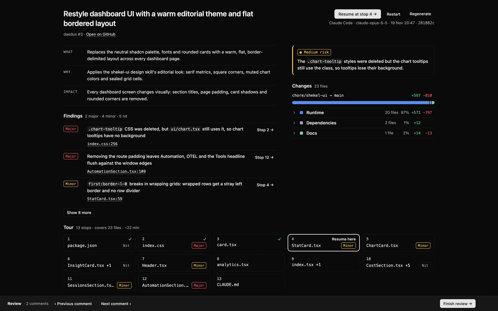
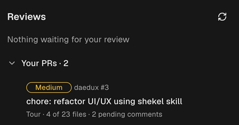
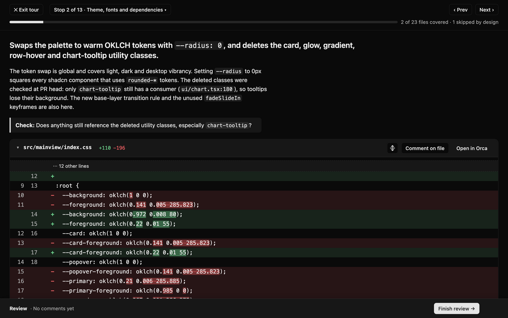
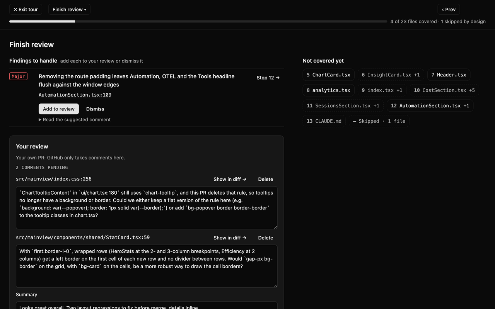
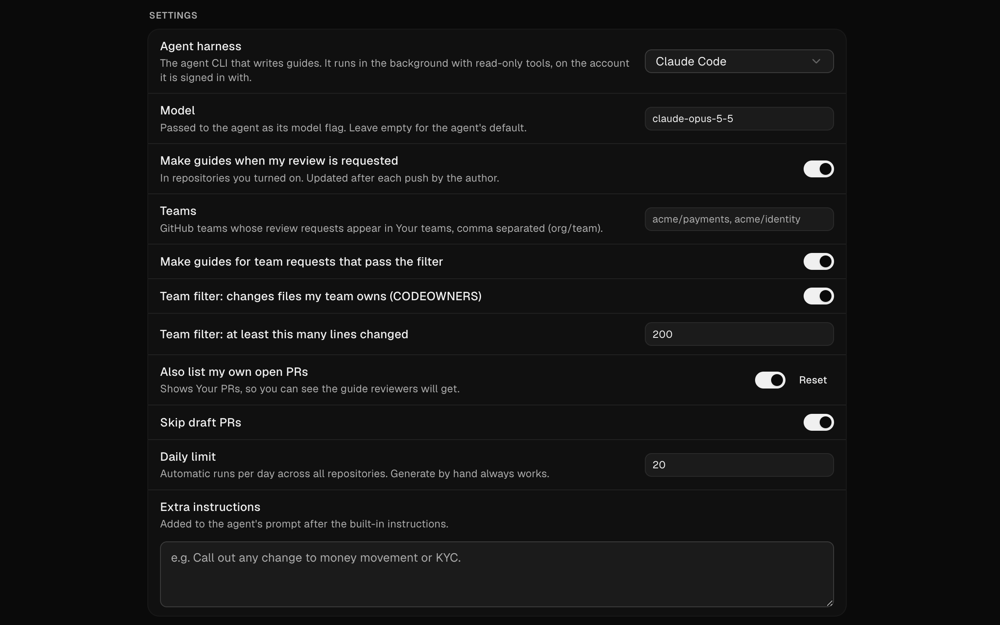

# PR Tour

An [Orca](https://github.com/stablyai/orca) plugin that lists the PRs waiting for your review, in
the order to review them, and has your own agent CLI write a guide for each one. You can then
review from the guide and post the review to GitHub without leaving Orca.



Each guide has:

- the risk, and what must happen before merge
- findings, each with a comment you can post
- what the PR does, why, and its impact
- a tour of every changed file, in reading order
- what changed since your last review

Everything runs on your machine with your own `gh` and agent sign-ins. Nothing reaches GitHub
until you press **Post to GitHub**.

## Install

You need Orca 1.4.259 or newer, `gh` signed in (`gh auth status`), and `claude` or `codex` signed
in.

```sh
orca plugin install adamthewilliam/orca-pr-tour
```

Orca lists what the plugin can access and prints the same command with `--approve <fingerprint>`.
Run that, then open the **Reviews** panel: the gauge icon in the right sidebar's tab bar.

Guides are read from a local clone, so add each repository you review to Orca as a project.

## Use it

### The queue



The panel checks GitHub every 5 minutes, or when you press refresh. It lists:

- PRs that request **your** review
- PRs for the **teams** you list in Settings, tagged with the team
- **Your PRs**, if you turn it on, so you can see the guide your reviewers get

Order: new commits since your review first, then high risk to low, then whoever has waited
longest. **Not queued** and **Your PRs** stay folded underneath.

The first time a repository shows up, the panel asks whether to keep guides up to date there.
Until you say yes, each PR gets a **Generate** button instead.

### The guide

Press a queue row to open its guide in an editor tab. It starts on the overview (risk, findings,
the changes by kind), then walks through the PR one stop at a time.



- **Deep stops** explain one idea with only the hunks that show it.
- **Skim stops** show one example of a routine change and list the other files.
- Lockfiles, generated files and pure renames are skipped by design and listed last.

Your place in the tour is saved, so **Resume** picks up where you left off.

### Review and post

- Hover a line and press **+** to comment. Shift+**+** on a second line makes it a range.
- **Comment on file** comments on the whole file.
- A finding's **Add to review** turns its suggested comment into a pending comment.
- The review bar steps through pending comments with ‹ ›.

The draft is saved per PR, so closing the tab loses nothing.

**Finish review →** shows the blocker and major findings you haven't handled yet, then your comments and a
summary. Choose **Comment**, **Request changes** or **Approve**, then press **Post to GitHub**.



If the PR moved since the guide was written, every line comment is checked against the new diff
first. Anything that no longer fits is shown for fixing, and nothing is posted.

### Elsewhere in Orca

- **Status bar**: `PR tour: High risk` for the focused branch, or `Reviews: N`. Click it to open
  the guide.
- **Command palette**: `PR Tour: Check for review requests`, `Open guide for this branch`,
  `Generate guide for this branch`.

## Customise

In Settings → Plugins → PR Tour:



- `Agent harness`: Claude Code or Codex.
- `Model`: passed as the agent's model flag. Empty uses the agent's default.
- `Teams`: GitHub teams to watch, as `org/team`, comma separated.
- Team filter: make guides only for team PRs that touch files your team owns (`CODEOWNERS`) and
  change at least 200 lines. Both are adjustable.
- `Daily limit`: automatic runs per day, 20 by default. **Generate** always works.
- `Extra instructions`: added to the agent's prompt, such as "Call out any change to money
  movement".

## What the agent can do

The agent runs in the background with read-only tools:

- Claude Code: `claude -p --tools Read,Grep,Glob,Bash`, with Bash limited to
  `git diff/show/log`, no MCP servers, no project settings from the PR's repo and no saved
  session.
- Codex: `codex exec --sandbox read-only`.

The PR is fetched into `refs/pr-tour/*` in your clone, so your working tree isn't touched. Guides
are written to `.pr-tour/` in the repo, which is added to `.git/info/exclude` so it never shows up
in `git status`.

## Limits

- Prompts hold up to 180k characters of diff. Past that, the agent reads the remaining files with
  its tools, and the guide records which files it saw and how.
- The agent's line numbers can be wrong. A finding whose line isn't in the diff becomes a comment
  on the whole file.
- Line counts follow your git `diff.algorithm`, so they can differ a little from GitHub's.
- On your own PR, GitHub only takes comments, so there's no Approve or Request changes.

## Develop

No build step: Orca transpiles the TypeScript when it loads.

```sh
bun install && orca plugin types .
bun run typecheck && bun run lint && orca plugin test .
orca plugin dev watch .   # load into Orca and stream logs; Ctrl-C unloads
```

See [CONTRIBUTING.md](CONTRIBUTING.md) for how it works, where things are, pull requests and
releases.

## Credits

The Changes breakdown on the overview comes from
[Diff Breakdown](https://github.com/adamthewilliam/orca-diff-breakdown). File icons are
[Catppuccin for VSCode Icons](https://github.com/catppuccin/vscode-icons) (MIT). See
[THIRD_PARTY_NOTICES.md](THIRD_PARTY_NOTICES.md).
